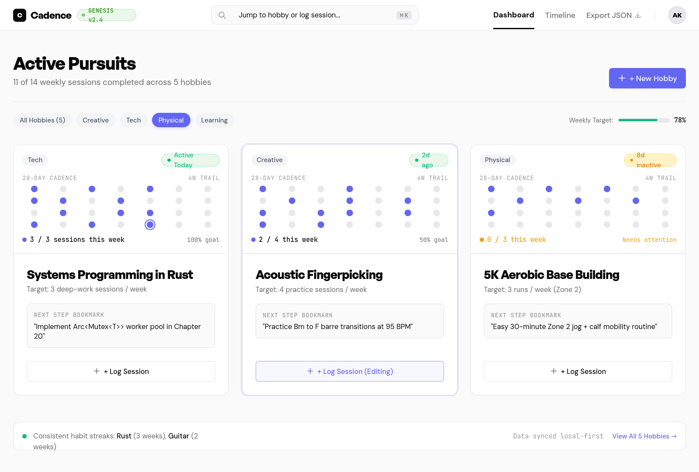

<div align="center">

# ❖ Cadence

**Editorial-Grade Deliberate Practice & Multi-Hobby Momentum Tracker**

*Engineered to translate deliberate practice into visual momentum — without guilt, streaks, or bloat.*

[](https://react.dev/)
[](https://www.typescriptlang.org/)
[](https://tailwindcss.com/)
[](https://vitejs.dev/)
[](./DESIGN.md)
[](LICENSE)

[**Explore Features**](#-key-features) • [**Design System**](#-genesis-design-system) • [**Architecture**](#-architecture--file-structure) • [**Getting Started**](#-getting-started) • [**Keyboard Shortcuts**](#-keyboard-shortcuts)

---

</div>

<p align="center">
  
</p>

---

## ✦ The Philosophy: Deliberate Practice > Streak Counters

Traditional habit trackers optimize for **streak preservation** — inducing anxiety, punishing missed days, and encouraging shallow check-the-box routines. 

**Cadence** is built on K. Anders Ericsson’s **Deliberate Practice framework**:
1. **Momentum Over Perfection**: An interactive 28-day habit matrix reveals density and rhythm without binary streak penalties. Missing a Tuesday never erases the mastery built on Monday.
2. **Context Preservation**: Every pursuit maintains a recessed **"Next Step Bookmark"** (*"Where I left off"*), eliminating context switching overhead so you dive straight into deep work.
3. **Intentional Logging**: Quick-log sessions with calibrated duration chips (`15m`, `30m`, `45m`, `60m`), structured notes, and immediate bookmark updates.
4. **Local-First Sovereignty**: 100% offline-ready with browser persistence, scoped multi-account support, and zero lock-in JSON export/import.

---

## ✦ Key Features & Views

```
               ┌────────────────────────────────────────────────────────┐
               │                        CADENCE                         │
               └───────────┬──────────────┬──────────────┬──────────────┘
                           │              │              │
                    /#landing      /#dashboard      /#timeline      /#account
                    (Genesis)      (Pursuits)       (Activity)     (Sovereignty)
```

### 1. Editorial Genesis Landing Page (`/#landing`)
- **Deliberate Practice Manifesto**: Contrasts Ericsson’s deliberate mastery principles against superficial streak counters.
- **Interactive Live Showcase**: 28-day habit matrix with hover inspector tooltips, interactive micro-logger, and dynamic target indicators.
- **In-Browser Sandbox ("Test Drive")**: Test practice sessions on the fly with duration chips, session notes, and 1-click handoff into the active dashboard.
- **Polymath Case Studies**: Production blueprints for Systems Architects (*Rust*), Multi-Instrumentalists (*Jazz Guitar*), Hybrid Athletes (*5K Aerobic*), and Polyglots (*Kanji*).
- **Subtle Editorial Navigation**: Direct hash navigation across `#landing`, `#dashboard`, `#timeline`, and `#account`, with global `⌘K` palette integration.

### 2. Active Pursuits Dashboard (`/#dashboard`)
- **28-Day Cadence Matrix**: 4-week interactive dot-grid header embedded inside every hobby card, displaying ISO-calibrated practice momentum with detailed tooltips.
- **Weekly Target Tracking**: Real-time ISO week completion rings and progress indicators.
- **Recessed Next-Step Bookmark**: Dedicated container displaying immediate next milestones (*e.g., "Implement Arc<Mutex<T>> worker pool"*).
- **Category Filter Chips**: Fast categorization across `Creative`, `Tech`, `Physical`, and `Learning`.
- **Single Primary CTA Enforcement**: Exactly one filled primary button (`+ New Hobby`) per view to maintain pristine visual hierarchy.

### 3. Practice Activity Timeline (`/#timeline`)
- **Chronological Activity Feed**: Reverse-chronological activity stream grouping deliberate practice sessions.
- **Relative Date Clustering**: Intelligent grouping under *"Today"*, *"Yesterday"*, and formatted calendar headers with total daily session and duration rollups.
- **Editorial Geometry**: Continuous 2px vertical spine, circular node bullets with canvas rings, and hover-elevated session cards.
- **Session Notes & Bookmarks**: Full retrospective view of deliberate practice notes and historical milestone progress.
- **Inline Rapid Logging**: One-click `+ Log Again` shortcut directly on timeline cards to log follow-up sessions instantaneously.

### 4. Account & Data Sovereignty Center (`/#account`)
- **Multi-Account Profile Management**: Switch or customize user profiles, display names, and signature avatar badge colors.
- **Practice Analytics**: Real-time rollups of lifetime hours invested, sessions completed, and active pursuits.
- **Practice Preferences**: Configure custom default weekly targets (1–7 sessions/week) and calendar week start preferences.
- **100% Data Sovereignty**: One-click JSON export backup, verified JSON restore, state reset, and account purge capabilities.

### 5. Deliberate Session Quick-Log Modal
- Accessible modal dialog triggered from cards or the timeline.
- Duration chips (`15m`, `30m`, `45m`, `60m`) with automated active states.
- Session reflection notes and synchronized Next Step Bookmark update checkbox.
- Comprehensive keyboard ergonomics (`Esc` dismiss, `Tab` focus trap, `Ctrl+Enter` save).

### 6. Zero-Bloat Command Palette (`⌘K` / `Ctrl+K`)
- Instant keyboard search filtering across hobby titles, categories, and bookmarks.
- Full keyboard traversal (`ArrowUp`, `ArrowDown`, `Enter`, `Esc`).

---

## ✦ Genesis Design System

Cadence strictly implements the **Genesis Design System** (Google Stitch specification), characterized by a light gallery-frame aesthetic and restrained visual tokens.

### Visual Tokens

| Token | Value | Applied To |
| :--- | :--- | :--- |
| **Primary** | `#6366F1` (Indigo) | Interactive CTAs, active pills, links, focus rings |
| **Primary Hover** | `#4F46E5` (Deep Indigo) | Interactive hover states |
| **Brand Highlight** | `#20970B` (Green) | Cadence brand dot in navigation header |
| **Surface** | `#FFFFFF` | Cards, panels, modals, dropdown backdrops |
| **Background** | `#FAFAFA` | Page canvas (warm light gallery gray) |
| **Text Primary** | `#0A0A0A` | Headings, high-contrast labels, primary copy |
| **Text Secondary**| `#6B6B6B` | Descriptions, metadata, secondary timestamps |
| **Border** | `#E8E8EC` | Subtle card borders, dividers, inputs |
| **Success** | `#10B981` | "On Track" status chips, positive confirmations |
| **Warning** | `#F59E0B` | "Needs Attention" status chips |

### Strict Typography & Two-Weight Rule

> [!IMPORTANT]
> **Strict Two-Weight Rule**: Only **Regular (400)** and **Bold (700)** font weights are permitted across the entire application. Intermediate weights (`500`, `600`) are prohibited and enforced by automated test suites (`npm test`).

- **Display & Headings**: `General Sans` (Fontshare CDN, bold 700 with `-0.035em` tracking).
- **Body & UI**: `DM Sans` (Google Fonts, regular 400).
- **Metrics & Code**: `JetBrains Mono` (Google Fonts, regular 400).

### Elevation & Border Radius Hierarchy

- **Elevation**: Flat surfaces by default. Elevation is reserved strictly for hover states (`0 8px 30px rgba(0,0,0,0.08)` with a `-2px` vertical lift) and modal overlays.
- **12px (`rounded-xl`)**: Hobby cards, Command Palette, modal dialogs, timeline cards.
- **8px (`rounded-lg`)**: Recessed next-step bookmark frames, dropdown panels.
- **6px (`rounded-md`)**: Action buttons, input fields, select dropdowns.
- **4px (`rounded-[4px]`)**: Monospace keyboard shortcut badges (`⌘K`, `Esc`).
- **9999px (`rounded-full`)**: Category pills, status chips, 28-day matrix dots, timeline bullets.

---

## ✦ Architecture & File Structure

```
cadence-google-build-with-ai-oct24/
├── public/                       # Static public assets
├── stitch_cadence_hobby_tracker_ui/
│   ├── code.html                 # Stitch design prototype reference
│   └── screen.png                # High-fidelity dashboard screenshot
├── src/
│   ├── components/
│   │   ├── AccountView.tsx       # Profile, analytics, and data sovereignty
│   │   ├── AuthModal.tsx         # Account sign-in / profile registration modal
│   │   ├── CommandPalette.tsx    # Global ⌘K search & filter modal
│   │   ├── HobbyCard.tsx         # Gallery card with 28-day habit matrix
│   │   ├── LandingView.tsx       # Editorial Genesis landing page & sandbox
│   │   ├── LogModal.tsx          # Quick-log session dialog with duration chips
│   │   ├── NewHobbyModal.tsx     # Add new pursuit configuration modal
│   │   ├── TimelineView.tsx      # Chronological practice activity stream
│   │   └── UserMenu.tsx          # Navigation user dropdown & account links
│   ├── App.tsx                   # Top-level shell, state, and hash routing
│   ├── auth.ts                   # Local-first multi-account session management
│   ├── index.css                 # Tailwind CSS v4 directives & font imports
│   ├── main.tsx                  # React 19 application entry point
│   ├── types.ts                  # Core domain models (Hobby, SessionLog, User)
│   ├── utils.ts                  # Date math, matrix calculators, JSON import/export
│   └── utils.test.ts             # Automated smoke & Genesis design token tests
├── DESIGN.md                     # Comprehensive Genesis design specification
├── package.json                  # Dependencies & scripts
└── vite.config.ts                # Vite 8 configuration with React plugin
```

---

## ✦ Getting Started

### Prerequisites
- **Node.js**: `v20.0.0` or higher
- **npm**: `v10.0.0` or higher

### Installation & Run

```bash
# 1. Clone the repository
git clone https://github.com/onlyysaurabh/cadence-google-build-with-ai-oct24.git
cd cadence-google-build-with-ai-oct24

# 2. Install dependencies
npm install

# 3. Start local development server (Vite on http://localhost:5173)
npm run dev
```

### Verification & Quality Checks

```bash
# Run automated utility tests & Genesis design token validation
npm test

# Run Oxlint for lightning-fast linting
npm run lint

# Typecheck and build optimized production bundle
npm run build
```

---

## ✦ Keyboard Shortcuts

| Shortcut | Action | Context |
| :--- | :--- | :--- |
| <kbd>⌘</kbd> <kbd>K</kbd> / <kbd>Ctrl</kbd> <kbd>K</kbd> | Open Command Palette | Global |
| <kbd>Esc</kbd> | Close Modal / Dismiss Palette | Global |
| <kbd>Ctrl</kbd> <kbd>Enter</kbd> / <kbd>⌘</kbd> <kbd>Enter</kbd> | Confirm & Save Session Log | Log Modal |
| <kbd>↑</kbd> / <kbd>↓</kbd> | Navigate Palette Results | Command Palette |
| <kbd>Enter</kbd> | Select Highlighted Pursuit | Command Palette |

---

## ✦ License

Distributed under the **MIT License**. Built with precision for the Google Build with AI Hackathon.
