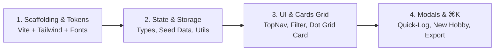

# Project Execution Plan: Cadence (Multi-Hobby & Interest Tracker)

> **Document Version:** 2.0.0 (Ponytail Streamlined)  
> **Target Design System:** Genesis Editorial Precision (Google Stitch compliant)  
> **Platform Target:** React + Vite (TypeScript), Tailwind CSS  
> **Deployment Target:** Firebase Hosting / Google Cloud Always Free Tier (Static Edge CDN)  
> **Aesthetic Mood:** Light gallery-frame editorial, quiet confidence, bold geometric typography, strict 4px grid  

---

## 1. Executive Summary & Design Vision

**Cadence** is an editorial-grade, multi-hobby progress tracker engineered to translate deliberate practice into visual momentum. Built strictly to the **Genesis design system**, Cadence uses a light, gallery-frame aesthetic: generous whitespace, high information density, strict typography, and zero decorative gradients or illustrations.

The **only** decorative visual element is an **interactive 28-day cadence dot-grid matrix** embedded directly into the 200px header preview frame of each hobby card.

```
+--------------------------------------------------------------------------------------------------+
| Cadence [Brand Badge]       [ ⌘K  Jump to hobby or log session... ]      Dashboard  Timeline  [Avatar] |
+--------------------------------------------------------------------------------------------------+
|                                                                                                  |
| Active Pursuits                                                            [ + New Hobby ] (CTA) |
| 11 of 14 weekly sessions completed across 5 hobbies                                              |
|                                                                                                  |
| [ All Hobbies ]  [ Creative ]  [ Tech ]  [ Physical ]  [ Learning ]                              |
|                                                                                                  |
| +-----------------------------+  +-----------------------------+  +----------------------------+ |
| | [Tech]     [On Track: Today]|  | [Creative]      [On Track]|  | [Physical]  [Needs Attention]| |
| |                             |  |                             |  |                            | |
| |  ● ● ○ ● ● ● ○  (Week 1)    |  |  ● ○ ● ● ○ ● ○              |  |  ○ ○ ○ ○ ○ ○ ○             | |
| |  ● ● ● ● ○ ● ●  (Week 2)    |  |  ○ ● ● ○ ● ○ ●              |  |  ○ ○ ○ ○ ○ ○ ○             | |
| |  ● ○ ● ● ● ● ○  (Week 3)    |  |  ● ● ○ ● ● ○ ○              |  |  ○ ○ ○ ○ ○ ○ ○             | |
| |  ● ● ● ○ ○ ○ ○  (Week 4)    |  |  ● ● ○ ○ ○ ○ ○              |  |  ○ ○ ○ ○ ○ ○ ○             | |
| |  2 / 3 sessions this week   |  |  2 / 4 sessions this week   |  |  0 / 3 sessions this week  | |
| +-----------------------------+  +-----------------------------+  +----------------------------+ |
| | Systems Programming in Rust |  | Acoustic Fingerpicking      |  | 5K Aerobic Base Building   | |
| | Target: 3 sessions / week   |  | Target: 4 sessions / week   |  | Target: 3 sessions / week  | |
| |                             |  |                             |  |                            | |
| | NEXT STEP BOOKMARK          |  | NEXT STEP BOOKMARK          |  | NEXT STEP BOOKMARK         | |
| | "Implement Arc<Mutex<T>>..."|  | "Practice Bm to F barre..." |  | "Easy 30-min Zone 2 jog..."| |
| |                             |  |                             |  |                            | |
| | [ + Log Session ] (Bordered)|  | [ + Log Session ] (Bordered)|  | [ + Log Session ] (Bordered)| |
| +-----------------------------+  +-----------------------------+  +----------------------------+ |
+--------------------------------------------------------------------------------------------------+
```

---

## 2. Ponytail Simplifications (YAGNI & Anti-Bloat Audit)

| Planned in v1.0 | Ponytail Decision | Justification |
| :--- | :--- | :--- |
| **`@radix-ui/react-*`** (Dialog, Tooltip, Dropdown) | **Cut**. Native React state + HTML `<dialog>` / accessible backdrop | Zero dependency overhead, zero bundle weight, 20 lines of TSX replaces 3 packages. |
| **`cmdk`** | **Cut**. Standard filtered list inside native modal dialog | 30 lines of standard React state covers ⌘K search without a 50kb dependency. |
| **`clsx` + `tailwind-merge`** | **Cut**. Native template literals | Unneeded for app-level code without a public headless UI library. |
| **18-File Component Sprawl** (`Button.tsx`, `Badge.tsx`, `Input.tsx`, `HobbyCardGrid.tsx`) | **Consolidated to 4 core components** | Micro-wrapper components around `<button>` and `<input>` are pure boilerplate. Direct Tailwind utility classes are cleaner and faster to maintain. |
| **Phase 2 Cloud Firestore + Firebase Auth** | **Deferred**. Local-first `localStorage` + JSON Import/Export | Day 1 needs zero auth friction, zero cloud latency, and 100% offline persistence. Export/import provides full user data sovereignty. |

---

## 3. Minimal Tech Stack

- **Build / Runtime:** Vite + React 18/19 (TypeScript)
- **Styling:** Tailwind CSS v4 or v3 (configured with Genesis tokens)
- **Icons:** `lucide-react` (clean, geometric 1.5px strokes)
- **Storage:** Browser `localStorage` + JSON Import/Export
- **Hosting:** Firebase Hosting / Cloudflare Pages / Static Edge (`dist/`)

---

## 4. Genesis Design System Specifications

### 4.1 Color Tokens

```
Canvas (#FAFAFA) ────────── Base page background (light warm gray)
Surface (#FFFFFF) ───────── Cards, modals, top nav, inputs
Border (#E8E8EC) ────────── 1px subtle borders for cards, inputs, dividers
Text Primary (#0A0A0A) ──── Headings, body text, primary labels (Never pure #000)
Text Secondary (#6B6B6B) ── Descriptions, metadata, targets
Neutral / Muted (#9C9C9C) ─ Timestamps, overline labels, placeholders
Primary Accent (#6366F1) ── Indigo: Strictly reserved for single Primary CTA, active dot, active chip
Primary Hover (#4F46E5) ─── Darker indigo for CTA hover state
Brand Highlight (#20970B) ─ Forest green: Single brand dot/badge in top nav
Semantic Success (#10B981)  "On Track" status chip
Semantic Warning (#F59E0B)  "Needs Attention" status chip
Semantic Error (#EF4444) ── Validation errors / delete actions
```

### 4.2 Typography & Two-Weight Rule
Maximum **two font weights** (`Regular` 400 and `Bold` 700) across the entire application:
- **Headings & Card Titles:** `General Sans` Bold (700) (`-0.03em` tracking).
- **Body & Labels:** `DM Sans` Regular (400).
- **Metrics, Counters & Overlines:** `JetBrains Mono` Regular (400).

---

## 5. Lean File Architecture (9 Files Total)

```
src/
├── types.ts              # Data interfaces (Hobby, SessionLog, Category) + Seed Data
├── utils.ts              # 28-day matrix math, weekly targets, relative status, storage/export/import
├── App.tsx               # App shell: TopNav, HeaderSummary, 3-column Grid, ⌘K listener
├── components/
│   ├── HobbyCard.tsx     # 200px dot matrix preview + bookmark + secondary log button
│   ├── LogModal.tsx      # Quick-log modal (duration chips, notes, bookmark update)
│   ├── NewHobbyModal.tsx # Add new pursuit modal
│   └── CommandPalette.tsx # Minimal ⌘K quick-jump search dialog
├── index.css             # Tailwind font declarations & custom utility classes
└── main.tsx              # React DOM entry
```

---

## 6. Data Model & Seed Data (`src/types.ts`)

```typescript
export type Category = 'Creative' | 'Tech' | 'Physical' | 'Learning';
export type SessionDuration = 15 | 30 | 45 | 60;

export interface SessionLog {
  id: string;
  date: string; // "YYYY-MM-DD" (local date)
  durationMinutes: SessionDuration;
  note: string;
  timestamp: number;
}

export interface Hobby {
  id: string;
  title: string;
  category: Category;
  weeklyTarget: number; // e.g. 3 sessions/week
  nextStepBookmark: string;
  createdAt: string;
  logs: SessionLog[];
}

export const INITIAL_HOBBIES: Hobby[] = [
  {
    id: 'hobby-rust',
    title: 'Systems Programming in Rust',
    category: 'Tech',
    weeklyTarget: 3,
    nextStepBookmark: 'Implement Arc<Mutex<T>> worker pool in Chapter 20',
    createdAt: '2026-09-01',
    logs: [
      { id: 'log-r1', date: '2026-10-24', durationMinutes: 60, note: 'Chapter 19 concurrency primitives', timestamp: 1729746000000 },
      { id: 'log-r2', date: '2026-10-22', durationMinutes: 45, note: 'Smart pointers and Deref', timestamp: 1729573200000 },
      { id: 'log-r3', date: '2026-10-20', durationMinutes: 45, note: 'Mutex locking mechanics', timestamp: 1729400400000 }
    ]
  },
  {
    id: 'hobby-guitar',
    title: 'Acoustic Fingerpicking',
    category: 'Creative',
    weeklyTarget: 4,
    nextStepBookmark: 'Practice Bm to F barre transitions at 95 BPM',
    createdAt: '2026-09-10',
    logs: [
      { id: 'log-g1', date: '2026-10-24', durationMinutes: 30, note: 'Clean barre execution at 98 BPM', timestamp: 1729746000000 },
      { id: 'log-g2', date: '2026-10-22', durationMinutes: 30, note: 'Alternating thumb bass with melody sync', timestamp: 1729573200000 },
      { id: 'log-g3', date: '2026-10-19', durationMinutes: 30, note: 'Dust in the Wind fingerstyle pattern intro', timestamp: 1729314000000 }
    ]
  },
  {
    id: 'hobby-running',
    title: '5K Aerobic Base Building',
    category: 'Physical',
    weeklyTarget: 3,
    nextStepBookmark: 'Easy 30-minute Zone 2 jog + calf mobility routine',
    createdAt: '2026-08-15',
    logs: [
      { id: 'log-run1', date: '2026-10-16', durationMinutes: 30, note: 'Slow recovery 3.2km run around park', timestamp: 1729054800000 }
    ]
  },
  {
    id: 'hobby-japanese',
    title: 'Japanese Kanji & Grammar',
    category: 'Learning',
    weeklyTarget: 2,
    nextStepBookmark: 'Review Wanikani Level 14 vocabulary & Genki II Ch 18',
    createdAt: '2026-09-15',
    logs: [
      { id: 'log-j1', date: '2026-10-23', durationMinutes: 45, note: 'Wanikani 40 reviews + JLPT N4 grammar test', timestamp: 1729659600000 },
      { id: 'log-j2', date: '2026-10-21', durationMinutes: 30, note: 'Genki chapter 18 conditional forms', timestamp: 1729486800000 }
    ]
  },
  {
    id: 'hobby-photo',
    title: 'Analog 35mm Photography',
    category: 'Creative',
    weeklyTarget: 2,
    nextStepBookmark: 'Develop Kodak Tri-X 400 roll in D-76 (1:1 dilution)',
    createdAt: '2026-08-20',
    logs: [
      { id: 'log-p1', date: '2026-10-24', durationMinutes: 45, note: 'Street photography session at morning market', timestamp: 1729746000000 },
      { id: 'log-p2', date: '2026-10-21', durationMinutes: 30, note: 'Archival negative sleeve labeling', timestamp: 1729486800000 },
      { id: 'log-p3', date: '2026-10-20', durationMinutes: 60, note: 'Darkroom chemical preparation and test strips', timestamp: 1729400400000 }
    ]
  }
];
```

---

## 7. Core Calculations & Storage Adapter (`src/utils.ts`)

```typescript
// ponytail: localStorage client persistence; upgrade to Cloud Firestore if multi-user sync is needed.
import { Hobby, SessionLog } from './types';

const STORAGE_KEY = 'cadence_hobbies_v1';

export function formatLocalDate(d: Date): string {
  const pad = (n: number) => n.toString().padStart(2, '0');
  return `${d.getFullYear()}-${pad(d.getMonth() + 1)}-${pad(d.getDate())}`;
}

export function loadHobbies(seed: Hobby[]): Hobby[] {
  try {
    const raw = localStorage.getItem(STORAGE_KEY);
    return raw ? JSON.parse(raw) : seed;
  } catch {
    return seed;
  }
}

export function saveHobbies(hobbies: Hobby[]): void {
  localStorage.setItem(STORAGE_KEY, JSON.stringify(hobbies));
}

export function exportBackup(hobbies: Hobby[]): void {
  const blob = new Blob([JSON.stringify(hobbies, null, 2)], { type: 'application/json' });
  const url = URL.createObjectURL(blob);
  const a = document.createElement('a');
  a.href = url;
  a.download = `cadence-backup-${formatLocalDate(new Date())}.json`;
  a.click();
  URL.revokeObjectURL(url);
}

export function importBackup(jsonString: string): Hobby[] {
  const data = JSON.parse(jsonString);
  if (!Array.isArray(data)) throw new Error('Backup must be an array of hobbies');
  for (const h of data) {
    if (!h.id || !h.title || !h.category || typeof h.weeklyTarget !== 'number' || !Array.isArray(h.logs)) {
      throw new Error('Invalid hobby data format');
    }
  }
  return data as Hobby[];
}

// 28-day window: [Today - 27d, ..., Today]
export function get28DayWindow(): string[] {
  const dates: string[] = [];
  const now = new Date();
  for (let i = 27; i >= 0; i--) {
    const d = new Date(now.getFullYear(), now.getMonth(), now.getDate() - i);
    dates.push(formatLocalDate(d));
  }
  return dates;
}

export function getWeeklyLogCount(logs: SessionLog[]): number {
  const now = new Date();
  const day = now.getDay() || 7; // ISO week (Mon=1 ... Sun=7)
  const monday = new Date(now.getFullYear(), now.getMonth(), now.getDate() - day + 1);
  const mondayStr = formatLocalDate(monday);
  return logs.filter(l => l.date >= mondayStr).length;
}

export function getStatus(logs: SessionLog[]): { label: string; isGreen: boolean } {
  if (logs.length === 0) return { label: 'Needs Attention — inactive', isGreen: false };
  const sorted = [...logs].sort((a, b) => b.date.localeCompare(a.date));
  const lastDate = sorted[0].date;
  const todayStr = formatLocalDate(new Date());
  if (lastDate === todayStr) return { label: 'On Track — Active Today', isGreen: true };
  
  const [ly, lm, ld] = lastDate.split('-').map(Number);
  const [ty, tm, td] = todayStr.split('-').map(Number);
  const lastTime = new Date(ly, lm - 1, ld).getTime();
  const todayTime = new Date(ty, tm - 1, td).getTime();
  const diffDays = Math.round((todayTime - lastTime) / (1000 * 60 * 60 * 24));

  if (diffDays === 1) return { label: 'On Track — Active Yesterday', isGreen: true };
  if (diffDays < 7) return { label: `On Track — ${diffDays}d ago`, isGreen: true };
  return { label: `Needs Attention — ${diffDays}d inactive`, isGreen: false };
}
```

---

## 8. Screen & Component Breakdown

### 8.1 Sticky Top Navigation (`App.tsx`)
- Height `56px`, `backdrop-blur-md bg-white/90`, `border-b border-[#E8E8EC]`.
- Wordmark: "Cadence" in `General Sans` Bold (`#0A0A0A`), small `#20970B` badge.
- ⌘K Search trigger bar: centered, `rounded-xl`, `bg-[#FAFAFA] border border-[#E8E8EC]`, shortcut badge `⌘K`.
- Right actions: "Export JSON" button + user avatar pill (`rounded-full`).

### 8.2 Header Summary & Category Chips (`App.tsx`)
- Left: Section title "Active Pursuits" (`32px` Bold), dynamic subtitle (e.g. "11 of 14 weekly sessions completed across 5 hobbies").
- Filter Chips: `All Hobbies`, `Creative`, `Tech`, `Physical`, `Learning` (`rounded-full`, active uses `#6366F1`, inactive uses `#F3F4F6`).
- Right: **Single Primary CTA** `+ New Hobby` (`bg-[#6366F1] text-white rounded-md py-2 px-4 shadow-[0_4px_12px_rgba(99,102,241,0.35)]`).

### 8.3 Hobby Card (`src/components/HobbyCard.tsx`)
- Surface: `#FFFFFF`, `border border-[#E8E8EC]`, `rounded-xl`, flat at rest, `-2px` hover lift with `0 8px 30px rgba(0,0,0,0.08)`.
- **Top 200px Preview:**
  - Overlays: Category pill (top-left) & Semantic Status pill (top-right: `#10B981` or `#F59E0B`).
  - 28-day dot matrix (4 rows $\times$ 7 columns, circular dots `rounded-full`, active `#6366F1`, rest `#E8E8EC`, with native `title` tooltip for date/notes).
  - Bottom-left metric: `X / Y sessions this week` in `12px JetBrains Mono`.
- **Bottom Content Area (`p-6`):**
  - Title (`24px` Bold) and weekly target subtitle (`13px` `#6B6B6B`).
  - Recessed Bookmark Box: `bg-[#FAFAFA] border border-[#E8E8EC] rounded-lg p-3`, overline `NEXT STEP BOOKMARK`, current next step text.
  - Footer Action: Full-width **Secondary Button** `+ Log Session` (`border border-[#E8E8EC] bg-transparent hover:bg-[#FAFAFA]`).

### 8.4 Quick-Log Modal (`src/components/LogModal.tsx`)
- Centered modal (`max-w-[480px] bg-white rounded-xl border border-[#E8E8EC] p-6 shadow-xl`).
- Duration selector chips: `15m`, `30m`, `45m`, `60m` (`rounded-full`, active `#6366F1`).
- Session note input: `rounded-md border-[#E8E8EC] focus:border-[#6366F1] focus:ring-2 focus:ring-[#6366F1]/20`.
- Update Bookmark toggle: checkbox + pre-filled input to replace next step bookmark on save.
- Recent 2 logs display (dates & durations in `JetBrains Mono`).
- Footer: Cancel (Ghost) + `Save Session` (Primary Indigo).

### 8.5 Command Palette (`src/components/CommandPalette.tsx`)
- Native modal dialog triggered by `⌘K` or top search click.
- Filter input with instant live search across hobbies, categories, and bookmarks.
- Quick click opens Quick-Log modal directly for the selected pursuit.

---

## 9. 4-Step Execution Roadmap



### Step 1: Scaffolding & Design Tokens (15 mins)
- Initialize Vite + React (TypeScript) + Tailwind CSS.
- Configure Google Fonts (`DM Sans`, `JetBrains Mono`) and Fontshare (`General Sans`) in `index.html`.
- Set up custom color tokens in `index.css` / Tailwind configuration.

### Step 2: Types, Seed Data & Storage (10 mins)
- Implement `src/types.ts` and `src/utils.ts`.
- Verify `localStorage` loading and seed data initialization.

### Step 3: Layout, Header & Hobby Cards (25 mins)
- Implement `App.tsx` shell: TopNav (sticky 56px), metrics header, and category filters.
- Implement `HobbyCard.tsx`: 200px preview with 28-day dot matrix, bookmark box, and secondary button.

### Step 4: Modals, Command Palette & Build (20 mins)
- Implement `LogModal.tsx`, `NewHobbyModal.tsx`, and `CommandPalette.tsx`.
- Connect JSON Export/Import.
- Run `npm run build` to verify production bundle. Deploy to Firebase Hosting static edge.

---

## 10. Verification & Quality Checklist

- [ ] **Single Primary CTA Rule:** Main screen contains only 1 filled indigo button (`+ New Hobby`).
- [ ] **Two Font Weights:** Only `Regular` (400) and `Bold` (700) rendered across all elements.
- [ ] **Radius Hierarchy:** Cards & Modals (`12px`), Bookmark (`8px`), Controls (`6px`), Dot/Pills (`9999px`).
- [ ] **Dot Matrix Responsiveness:** Logging a session turns today's dot `#6366F1` and updates weekly cadence counter immediately.
- [ ] **Bookmark Synchronization:** Checking "Update bookmark" in Quick-Log reflects immediately on the card's bookmark frame.
- [ ] **Persistence & Export:** F5 refresh maintains all state; JSON export produces valid downloadable file.
